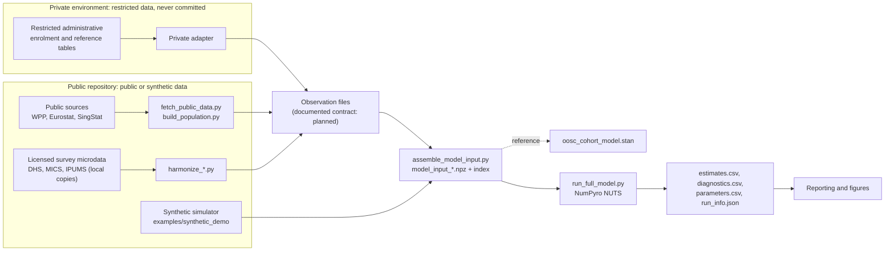
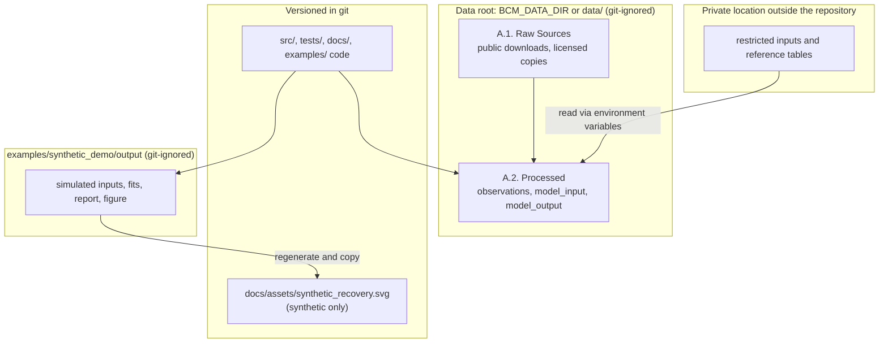
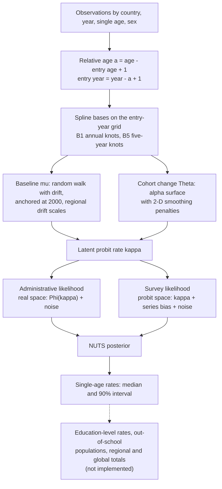
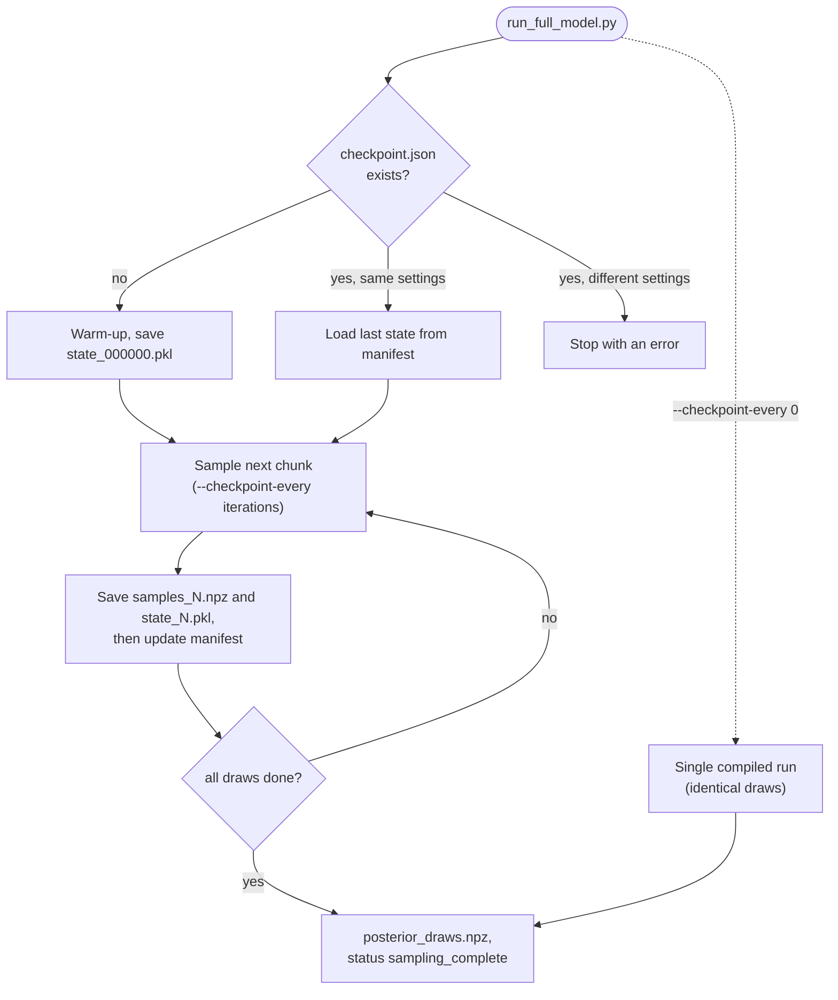

# Bayesian Cohort Model Reproduction

An independent reproduction, in NumPyro/JAX with an equation-level Stan reference, of a Bayesian cohort model for estimating out-of-school rates for SDG indicator 4.1.4.

> **Status: work in progress — not a completed reproduction.** The model, data pipeline and a synthetic end-to-end run are implemented and tested. Agreement with the published results has **not** been verified, and the indicator-level outputs (education-level rates, out-of-school populations, regional and global aggregates) are not implemented yet. See [docs/status.md](docs/status.md) for the evidence behind every status label.

> **Scope boundary:** This is not the official UNESCO, UIS, or GEM Report model and it does not publish official estimates.

**Reproduced work:** Dharamshi, A., Antoninis, M., Montoya, S. & Barakat, B. F. (2023). *A Bayesian cohort model for estimating out-of-school rates and populations.* SocArXiv. https://doi.org/10.31235/osf.io/sqwb2 [TODO: verify citation — the Stan source header cites a 2022 UIS/GEMR version with a different title; confirm which version the code's section and equation numbers follow.]

**Data boundary:** Restricted inputs are stored locally or in a separate private environment and are never committed to this repository. Everything here runs on synthetic data.

## Quick start

Requires Python 3.11 or newer. Tested in CI on Python 3.11 and 3.13 (Linux, CPU).

    git clone https://github.com/EllenSyuu/BCM.git
    cd BCM
    python -m venv .venv
    source .venv/bin/activate              # Windows: .venv\Scripts\activate
    python -m pip install -r requirements.lock
    python -m pip install --no-deps -e .
    pytest -q                              # about 2 minutes on a 2-core CPU
    python examples/synthetic_demo/run_demo.py

`requirements.lock` pins the exact versions tested in CI; `pyproject.toml` is the single place where dependencies are declared (see [docs/reproducibility.md](docs/reproducibility.md)).

## Synthetic demo

`examples/synthetic_demo/run_demo.py` exercises the same fitting entry point used for real data:

1. simulates 4 countries × 23 years (2000–2022) × 8 single ages from a known out-of-school surface, with noisy administrative observations and biased, noisy survey observations;
2. writes the model input in the format produced by `assemble_model_input.py`;
3. runs `src/python/run_full_model.py` with durable checkpoints (`--checkpoint-every 80`, 2 chains, 300 warm-up and 160 retained iterations per chain);
4. compares the posterior estimates with the known truth and draws a recovery figure.

**Expected runtime:** about 1 minute, including JAX compilation (49 s measured on a 2-core Linux CPU).

**Outputs** (all under `examples/synthetic_demo/output/`, which is git-ignored):

| File | Content |
|---|---|
| `demo_report.md` | Recovery and convergence summary (also printed to the console) |
| `demo_summary.json` | The same summary in machine-readable form |
| `synthetic_recovery.svg` | Recovery figure (below) |
| `synthetic_truth.csv` | The known rates used to simulate the data |
| `A.2. Processed/model_output/SYNTH/estimates.csv` | Posterior median and 90% interval for every country × year × age cell |
| `A.2. Processed/model_output/SYNTH/diagnostics.csv`, `parameters.csv`, `run_info.json` | R-hat/ESS per parameter, variance components, run settings and convergence checks |
| `A.2. Processed/model_output/SYNTH/checkpoints/` | Resumable sampler states and posterior chunks |

**Interpretation.** The demo checks that the pipeline runs end to end and can recover a surface it was simulated from. A typical run (seed 2022) places 88–90% of the true rates inside the 90% posterior intervals, with a mean absolute error of about 0.7 percentage points; the exact figures vary slightly across JAX versions. The run is deliberately short, so it does **not** meet the convergence thresholds used for real fits (R-hat ≤ 1.01, ESS ≥ 400, no divergences); `run_info.json` reports this explicitly. These numbers describe simulated data only and say nothing about agreement with the published estimates.

*Figure: synthetic recovery check (seed 2022, Python 3.13 / JAX 0.12). Panel A plots every estimated cell against its known true rate; orange rings mark true rates outside the 90% interval. Panel B follows one relative age over time; the synthetic country SYD has administrative data only every third year. Regenerate with `python examples/synthetic_demo/run_demo.py`, then `python examples/synthetic_demo/plot_recovery.py --svg docs/assets/synthetic_recovery.svg`. Further figures are planned in [docs/visualization-plan.md](docs/visualization-plan.md).*

## How it works

The diagrams describe the code as it is today; dashed boxes are planned and not implemented.

**Pipeline and the data boundary.** Everything left of the boundary is public and runs in this repository; restricted inputs enter only through a private adapter that writes files in the model's input format.

**What is written where.** All local inputs and outputs sit under one data root (`BCM_DATA_DIR`, or the git-ignored `data/`); only code, docs, tests and the synthetic figure are versioned.

**Model workflow.** The probit-scale rate for country *c*, year *y* and relative age *a* is a cohort baseline evaluated at the entry year plus an age-specific cohort change (see [docs/model-notes.md](docs/model-notes.md)).

**Checkpointing and resumption.** With checkpoints on, sampling runs in chunks; each chunk is saved before the manifest advances, so an interrupted run resumes from the last saved state and produces the same draws as an uninterrupted run (tested in `tests/test_checkpointing.py`).

## Running the pipeline on local data

All scripts read and write under one data root:

- `BCM_DATA_DIR` (absolute path), if set — recommended, so licensed or restricted inputs live outside the repository;
- otherwise `<repository>/data`, which is git-ignored.

[`.env.example`](.env.example) lists every variable. The scripts read environment variables only, so export them in your shell. Paths are resolved in [`src/python/bcm_paths.py`](src/python/bcm_paths.py) and never depend on the current working directory.

Pipeline order for an authorised local run (see [docs/architecture.md](docs/architecture.md) and [docs/data-sources.md](docs/data-sources.md)):

1. public population denominators: `fetch_public_data.py`, then `build_population.py`;
2. survey harmonisation: `harmonize_dhs.py`, `harmonize_mics.py`, `harmonize_ipums_census.py` (licensed microdata required);
3. administrative observations: produced by a private adapter that is not part of this repository;
4. model input: `assemble_model_input.py --sex MF` (also `M`, `F`);
5. fit: `run_full_model.py --tag MF` (paper settings by default: 4 chains, 2,000 warm-up, 2,000 draws, thinning 8).

## Repository map

    src/python/              Pipeline modules and command-line entry points (NumPyro model, harmonisers, runner)
    src/admin/               Administrative-only preliminary fit (smoke test, not the reproduction)
    src/stan/                Equation-level Stan reference model
    examples/synthetic_demo/ Synthetic end-to-end demonstration
    tests/                   Automated tests (synthetic inputs only)
    docs/                    Status, architecture, model notes, data sources, performance, reproducibility

Start with [docs/status.md](docs/status.md), then [docs/model-notes.md](docs/model-notes.md) and [docs/architecture.md](docs/architecture.md). The data and publication boundary is described in [PUBLICATION_NOTES.md](PUBLICATION_NOTES.md).

## Citation

See [CITATION.cff](CITATION.cff).
