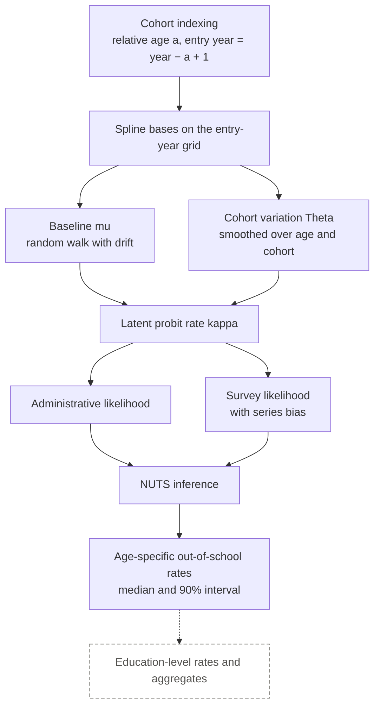
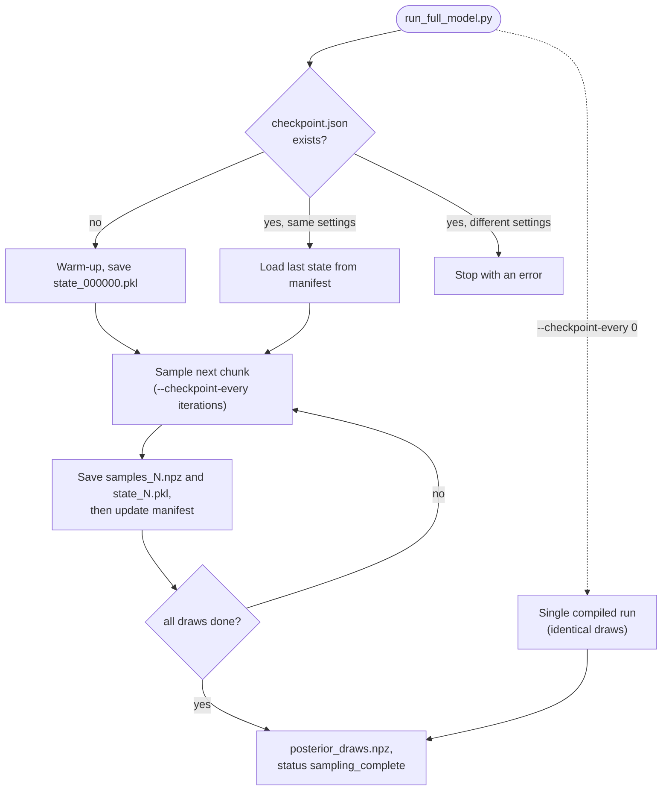

# Model workflow

How an observation becomes an estimate. Equation-level choices and known deviations are in [model-notes.md](model-notes.md); which parts are verified is in [status.md](status.md). Dashed elements are planned, not implemented.

1. **Cohort indexing.** Each observation (country, year, single age, sex) is mapped to a relative age (1 = the country's minimum entry age) and to the year its cohort entered school.
2. **Spline bases.** Cubic B-spline bases are built on the entry-year grid: annual knots for the baseline and five-year knots for the cohort variation (`spline_basis.py`).
3. **Baseline mu.** A random walk with a country-specific drift on the annual spline coefficients, anchored at 2000, with regional drift scales.
4. **Cohort variation Theta.** A surface of age-by-cohort changes with smoothing penalties in both directions; the entry age carries no change.
5. **Latent rate kappa.** The probit-scale out-of-school rate is mu plus Theta.
6. **Likelihoods.** Administrative rates are compared in real space (the normal CDF of kappa, with administrative and regional noise); survey rates in probit space (kappa plus a country-by-series bias, with sampling and wave noise).
7. **Inference.** NUTS in Stan through the R package (`r/oosccohort`, model in `inst/stan/oosc_cohort_model.stan`) or in NumPyro (`oosc_model_numpyro.py`). The two implementations are tested to define the same log density.
8. **Outputs.** `run_full_model.py` reports the posterior median and 90% interval for every country × year × relative age, plus diagnostics and variance components.
9. **Planned.** Aggregation from single ages to education levels, out-of-school populations, and regional and global totals.

## Checkpointing and resumption

With `--checkpoint-every N`, sampling runs in chunks. Each chunk's draws and the sampler state are written before `checkpoint.json` advances, so an interrupted run resumes from the last saved state and reproduces the draws of an uninterrupted run. With `--checkpoint-every 0` the sampler runs once; for the same seed it returns identical draws (`tests/test_checkpointing.py`, CPU, one chain).

